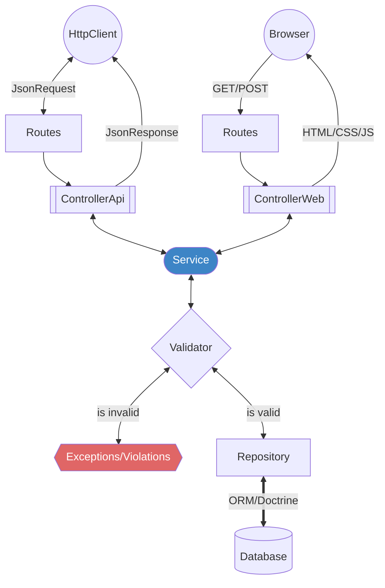

[](https://codecov.io/gh/ecossistema-aurora/aurora)

# Estrutura inicial Aurora

Este repositório fornece uma configuração base de aplicação Symfony com Docker, Nginx e PostgreSQL para substituir o projeto Aurora utilizado no Ceará.

A configuração já está dockerizada, então você só precisa ter o Docker Compose rodando na sua máquina para que tudo funcione corretamente.

## Tecnologias

- **PHP** 8.4
- **PostgreSQL** 16
- **MongoDB** 7
- **Symfony** 7
- **Aurora User Interface** 5.3 

## Links Rápidos
- [Acesse aqui para entender melhor nossa Stack](./help/STACK.md)
- [Acesse aqui para entender nossas decisões de backend](./help/TECHNICAL-DECISIONS.md)
- [Esquema do Banco de Dados](./help/DIAGRAM.md)
- [Como criar issues](./help/CREATE-ISSUES.md)
- [Como abrir Pull Requests](./help/CREATE-PULL-REQUESTS.md)
- [Nosso Fluxo de Desenvolvimento](./help/DEV-FLOW.md)
- [Enums](./help/ENUM.md)
- [Arquitetura da Aplicação](./help/README.md)
- [Comandos do terminal](./help/COMMANDS.md)
- [Deploy](./help/DEPLOY.md)

## Instalação 
<details>
<summary>Passo a passo</summary>

### Clonar o Repositório

Primeiro, clone o repositório usando SSH ou HTTPS:

```bash
git clone git@github.com:secultce/aurora.git
```
ou
```bash
git clone https://github.com/secultce/aurora.git
```

### Navegar para o Diretório do Projeto
Mude para o diretório do projeto:

```bash
cd aurora
```

---
>
> O jeito mais fácil é rodar o comando `make setup`, isso já vai executar todos os passos necessários e deixar a aplicação rodando em <http://localhost:8080>
>
```bash
cp .env.example .env
make setup
```
Mas se preferir, pode fazer o passo a passo abaixo, mas o compando de copiar o `.env` é obrigatório

---

### Iniciar os Contêineres Docker
Execute o Docker Compose para iniciar os contêineres:
```bash
docker compose up -d
```

### Instalar Dependências
Para instalar as dependências do projeto, entre no contêiner PHP:
```bash
docker compose exec -it php bash
```
**Agora é necessário executar alguns passos, nessa ordem, dentro do contêiner:**

1 - Instalação das dependências do PHP:
```bash
composer install
```

2 - Gerar os arquivos de Proxies do MongoDB:
```bash
php bin/console doctrine:mongodb:generate:proxie
```

3 - Executar as migrations do banco de dados
```bash
php bin/console doctrine:migrations:migrate -n
```

4 - Executar as fixtures (dados de teste) do banco de dados
```bash
php bin/console doctrine:fixtures:load -n
```

5 - Instalação das dependências do frontend:
```bash
php bin/console importmap:install
```

6 - Compilar os arquivos do frontend
```bash
php bin/console asset-map:compile
```

7 - Gerar as chaves de autenticação
```bash
php bin/console lexik:jwt:generate-keypair
```

### Uso

Depois que tudo estiver configurado e as dependências instaladas, você pode acessar a sua aplicação Symfony em:
- **Padrão:** [http://localhost:8080](http://localhost:8080)
- **Via Proxy Reverso (com override):** [http://aurora.localhost](http://aurora.localhost)
- **Via `/etc/hosts`** (sem necessidade de proxy)
  - **Alterando a porta:** [http://aurora.local](http://aurora.local)
  - **Sem mudar a porta:** [http://aurora.local:8080](http://aurora.local:8080)

<details>
<summary>Configuração com Proxy Reverso (Passo a passo)</summary>

Caso queira utilizar um proxy reverso para acessar a aplicação diretamente via [http://aurora.localhost](http://aurora.localhost) (na porta padrão 80):

#### 1. Criar a rede do proxy
Execute no terminal para criar a rede compartilhada Docker:
```bash
docker network create dev-proxy
```

#### 2. Iniciar o Proxy Reverso (Traefik)
Suba o contêiner do Traefik escutando na porta 80:
```bash
docker run -d \
  --name dev-proxy \
  --restart unless-stopped \
  -p 80:80 \
  -v /var/run/docker.sock:/var/run/docker.sock:ro \
  --network dev-proxy \
  traefik:v3.7 \
  --api.dashboard=true \
  --providers.docker=true \
  --providers.docker.network=dev-proxy \
  --providers.docker.exposedbydefault=false \
  --entrypoints.web.address=:80
```

#### 3. Criar o arquivo `docker-compose.override.yml`
Na raiz do projeto **Aurora**, crie o arquivo `docker-compose.override.yml` (já configurado no `.gitignore`):

```yaml
services:
  nginx:
    networks:
      - dev-proxy
    labels:
      - "traefik.enable=true"
      - "traefik.http.routers.aurora.rule=Host(`aurora.localhost`)"
      - "traefik.http.services.aurora.loadbalancer.server.port=80"

networks:
  dev-proxy:
    external: true
```

#### 4. Subir os contêineres
Execute o Docker Compose para aplicar o override:
```bash
docker compose up -d
```
Pronto! A aplicação estará acessível em [http://aurora.localhost](http://aurora.localhost).

> *(Caso já utilize outro nome para a rede do seu proxy reverso local, basta substituir `dev-proxy` pelo nome da sua rede).*

</details>

> Há também uma rota de teste para a API disponível em `/api/example` (ex.: [http://localhost:8080/api/example](http://localhost:8080/api/example) ou [http://aurora.localhost/api/example](http://aurora.localhost/api/example)). Esta rota está definida no controller `ExampleController` e retorna a mensagem de sucesso.

#### Usuário padrão
Há alguns usuários que você pode utilizar para fins de teste:

<table>
<tr>
<th>email</th>
<th>senha</th>
</tr>
<tr>
<td>mariadebetania@example.com</td>
<td>Aurora@2024</td>
</tr>
<tr>
<td>saracamilo@example.com</td>
<td>Aurora@2024</td>
</tr>
<tr>
<td>paulodetarso@example.com</td>
<td>Aurora@2024</td>
</tr>
</table>

</details>


## Desenvolvimento
<details>
<summary>Arquitetura e Decisões técnicas</summary>

Estamos utilizando o Symfony e o seu ecossistema de bibliotecas, porém a arquitetura é baseada em camadas e trata-se de um monolítico com a metodologia API First



- Para saber mais sobre as nossas decisões técnicas [acesse aqui](./help/TECHNICAL-DECISIONS.md)
- Para entender o nosso fluxo de desenvolvimento decisões técnicas [clique aqui](./help/DEV-FLOW.md)
</details>

## Design UI/UX
<details>
<summary>Informações importantes</summary>

### Prototipação das telas
A prototipagem das telas é feita por outro time, do RedeMapas, e se encontra [neste link do Figma](https://www.figma.com/design/HkR1qdfHPn4riffcBBOQwR/Prot%C3%B3tipos-%7C-Prioriza%C3%A7%C3%B5es?node-id=0-1&t=n23kLvhTSbEMELhz-0) 

### Componentes web
Há um fork do Bootstrap (framework css) com a implementação dos protótipos acima, se encontra [neste repositório](https://github.com/secultce/aurora-ui)

### Decisões de Design
Alguns protótipos implementados não estão seguindo a risca o design sugerido, por decisões totalmente técnicas que estão [documentadas aqui](https://github.com/secultce/aurora-ui/blob/main/help/design-decisions.md)
</details>

